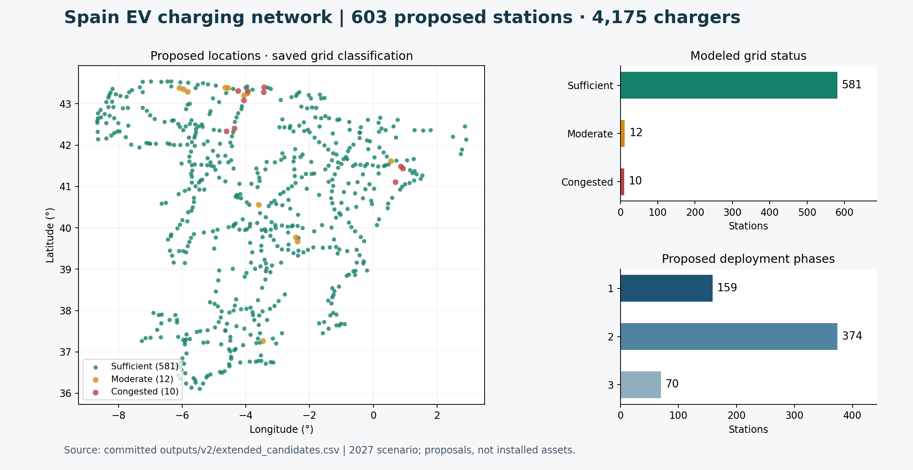

# Spain EV Charging Network Planning

**IE × Iberdrola Sustainability Datathon 2026 · 2027 planning scenario**

Where could fast chargers close gaps on Spain's interurban roads, and where might the electricity grid constrain deployment? This team project combines road coverage, projected EV demand, existing charging supply, nearby amenities, and substation capacity to propose a phased network.

**Explore:** [methodology report](v2/METHODOLOGY_REPORT.md) · [proposed stations](outputs/v2/File%202.csv) · [grid friction points](outputs/v2/File%203.csv) · [run instructions](docs/REPRODUCING.md) · [credits](docs/CREDITS.md)



*Generated from the committed v2 CSVs. Coordinates show proposed sites, rather than installed chargers. No road basemap or verified network coverage is implied.*

## Saved results

The current implementation is **`v2/`**, a hybrid coverage and demand pipeline. Its outputs differ from the earlier v1 results in the top-level `outputs/` folder.

| Saved v2 result | Value | Evidence |
| --- | ---: | --- |
| Proposed stations | 603 | [File 2](outputs/v2/File%202.csv) |
| Proposed 150 kW chargers | 4,175 | [Extended candidates](outputs/v2/extended_candidates.csv) |
| Total proposed charger capacity | 626,250 kW | Extended candidates; charger count × 150 kW |
| Existing interurban baseline | 7,106 | [File 1](outputs/v2/File%201.csv); 5 km road-buffer heuristic |
| Grid friction points | 22 | [File 3](outputs/v2/File%203.csv): 12 Moderate, 10 Congested |
| Projected EV fleet for 2027 | 659,323 | [Saved SARIMA projection](data/processed/ev_projection_results.json) |
| Deployment phases 1 / 2 / 3 | 159 / 374 / 70 stations | Extended candidates |

These are **saved model outputs**, checked for internal consistency on 2026-11-18. They are proposals and a forecast, rather than observed deployment outcomes. The full geospatial pipeline and forecast were not rerun during publication preparation because required input data is absent. The tracked files do not establish an award, forecast accuracy, realized cost savings, or deployment outcome.

The earlier v1 workflow produced 390 stations and 30 friction points. Those CSVs remain for reference; use **`outputs/v2/`** for the final saved version.

## Method and tools

1. Aggregate MITMA road micro-segments into approximately 20 km analytical segments.
2. Generate coverage candidates from existing fast chargers, targeting gaps of at most 60 km.
3. Estimate demand from traffic and the 2027 EV forecast; compare it with existing supply.
4. Merge candidates, score amenities, and assign charger counts.
5. Match substations, estimate missing capacity, and adjust sizing for modeled grid constraints.
6. Rank sites, assign deployment phases, export CSVs, and generate a Folium map.

Main planning assumptions live in [v2/config.py](v2/config.py). Tools include Python 3.11, pandas, NumPy, GeoPandas, Shapely, PyProj, SciPy, statsmodels/pmdarima, Matplotlib, Folium, OSMnx, and osmium. The original Conda environment also retains exploratory notebook and modeling tools.

## Run and inspect

Validate the saved deliverables from the repository root using only the Python standard library:

```bash
python3 tools/verify_publication.py
```

For the analysis environment:

```bash
conda env create -f environment.yml
conda activate datathon
python v2/run_pipeline.py --check-inputs
```

The input check currently reports missing GeoPackages and amenity files. Follow the [reproduction guide](docs/REPRODUCING.md) to restore them. Once inputs and dependencies are available:

```bash
python v2/run_pipeline.py
```

The runner selects the `v2/` working directory automatically. It overwrites the v2 CSVs and intermediates, and generates `visualizations/v2_ev_network_map.html`. Back up saved results before rerunning. Direct step scripts require `v2/` as their working directory; ingestion scripts in `notebooks/` use the repository root.

The interactive map is **not committed**. Its Folium output uses external JavaScript/CSS and map tiles; fully offline operation has not been established. The static image above is available without rerunning the pipeline. Regenerate it with `python tools/plot_results.py` in the analysis environment.

## Repository guide

| Path | Purpose |
| --- | --- |
| [v2/](v2/) | Current six-step pipeline and methodology report |
| [outputs/v2/](outputs/v2/) | Final saved KPIs, sites, friction points, and extended analysis |
| [notebooks/](notebooks/README.md) | Shared ingestion, earlier v1 analysis, historical notebook utilities |
| [outputs/](outputs/) | Earlier v1 CSVs alongside the separate v2 folder |
| [data/processed/](data/processed/) | Small saved processed inputs and forecast evidence |
| [DATA_SOURCES.md](DATA_SOURCES.md) | Original source inventory; exact registration-data fork needs confirmation |
| [docs/](docs/PUBLICATION.md) | Verification, credits, reproduction notes, and portfolio image |
| [tools/](tools/) | Deliverable validation and chart generation |

Original folders and output names remain in place to preserve working paths. Regenerable logs, caches, duplicate v1 co-location data, and v2 intermediate CSVs were removed from the publication tree; the original commit preserves them.

## Assumptions and provenance

- The 60 km corridor gap is a design target. An independent post-siting coverage check is still needed; saved CSVs cannot establish road connectivity or a coverage guarantee.
- Most substation capacities are estimated from voltage. A modeled grid status is not a distributor's connection approval or an engineering feasibility study.
- EV adoption, charging behavior, supply defaults, and grid thresholds are scenario assumptions. Sensitivity analysis and forecast validation remain future work.
- The 5 km baseline includes stations of different power levels. It differs from the fast-charger subset used for coverage.
- The source contains one commit by Marco Sinaniz. His authorship and the upstream attribution are preserved. The full team roster and individual roles need confirmation; this copy does not establish sole authorship.

This code and CSV project includes a [Markdown methodology report](v2/METHODOLOGY_REPORT.md). No final PDF report or presentation is tracked. The excluded competition briefing PDF is not the team's report.

The source repository is private and has no license. Confirm team permission and dataset redistribution terms before making a public copy. See [remaining publication work](docs/PUBLICATION.md). This preparation makes local changes only.
